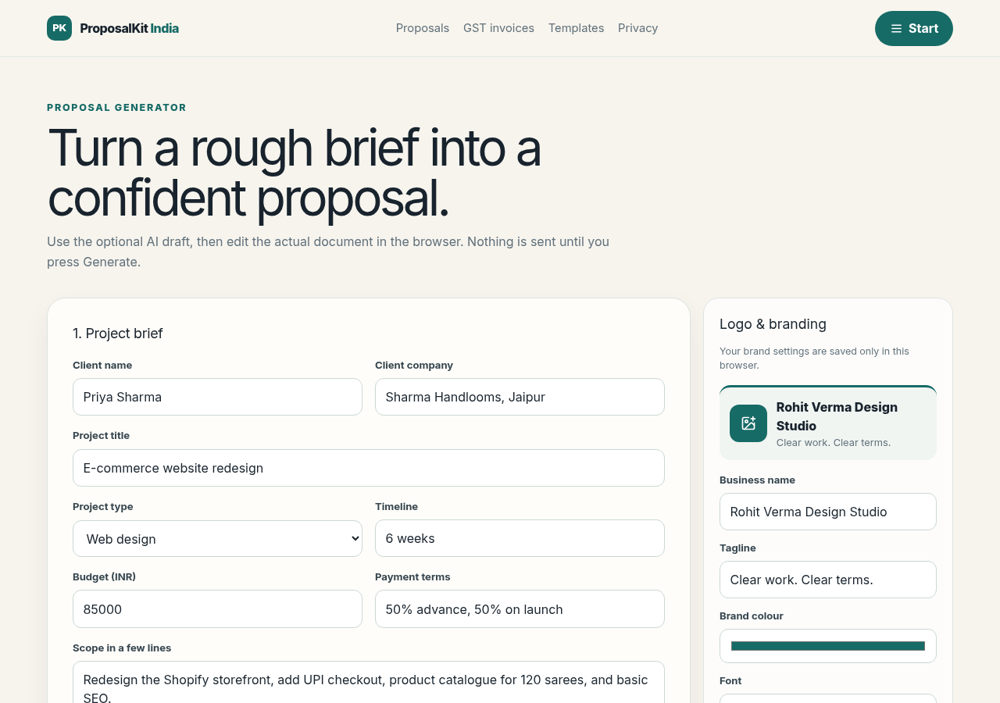
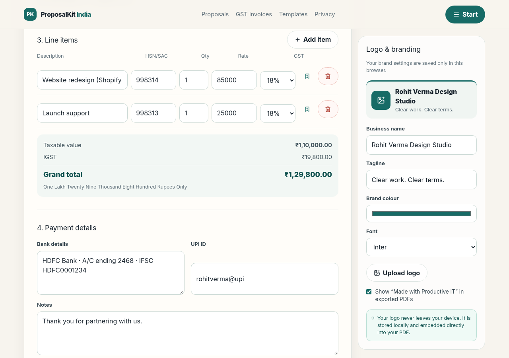

# ProposalKit India

[](https://vercel.com/new/clone?repository-url=https%3A%2F%2Fgithub.com%2Fvirrdhiman%2Fproposalkit-india&project-name=proposalkit-india&repository-name=proposalkit-india&env=GROQ_API_KEY&envDescription=Optional%3A%20Groq%20API%20key%20for%20AI%20proposal%20drafts.%20Leave%20blank%20to%20use%20the%20built-in%20editable%20templates.&envLink=https%3A%2F%2Fconsole.groq.com%2Fkeys)

**Live demo:** [https://proposalkit-india.vercel.app](https://proposalkit-india.vercel.app)

| Proposal generator | GST invoice generator |
| --- | --- |
|  |  |

Free, local-first proposal and GST invoice generator for Indian freelancers and small agencies. Create polished PDFs without an account; optional AI proposal drafting uses a server-only Groq-compatible API key.

## Features

- Proposal generator for web design, apps, SEO, video, consulting and custom work.
- Optional AI draft route using `openai/gpt-oss-120b`, with zod validation, per-IP rate limiting and a clean local fallback.
- Editable proposal sections and browser-generated PDFs.
- GST invoice generator with line-level 0%, 5%, 12%, 18% and 28% rates, same-state CGST + SGST, inter-state IGST, GSTIN format validation and Indian amount-in-words.
- Browser-only logo and branding settings (PNG/JPG/SVG, max 2 MB), with remove-logo control.
- Local save/reuse for clients and a JSON export/import flow.
- SEO pages, metadata, sitemap, robots, `llms.txt`, JSON-LD and accessibility-friendly forms.

## Deploy on Vercel

1. Click **Deploy with Vercel** above and sign in with GitHub.
2. `GROQ_API_KEY` is **optional**. Leave it blank and the app still builds and runs; the proposal page falls back to editable templates. Add a key later under Project → Settings → Environment Variables to turn on AI drafts.
3. After the first deploy, paste the URL into the **Live demo** line at the top of this README.

## Run locally

Requirements: Node.js 20+ and npm.

```bash
npm install
cp .env.example .env.local
# Optional: add GROQ_API_KEY to .env.local for AI drafts
npm run dev
```

Open [http://localhost:3000](http://localhost:3000).

## Checks

```bash
npm run typecheck
npm run lint
npm test
npm run test:e2e
npm run build
```

Playwright downloads a browser on first use if needed: `npx playwright install chromium`.

## Environment variables

| Variable | Required | Purpose |
| --- | --- | --- |
| `GROQ_API_KEY` | No | Server-only key for optional AI proposal drafts. |

Never prefix this key with `NEXT_PUBLIC_`; it must not be exposed to the browser. No secrets are included in this repository.

## Deploy to Vercel

1. Import the repository into Vercel.
2. Use the default Next.js build settings.
3. Add `GROQ_API_KEY` in the Vercel project Environment Variables if AI drafts are wanted.
4. Deploy. The app works without the key; proposal generation falls back to an editable template.

The rate limit is intentionally in-memory and per runtime instance. For a larger production deployment, move rate limiting to a managed edge store while preserving the no-document-storage design.

## Data and privacy

Invoice data, proposal data, saved clients/items and brand settings stay in the browser. PDFs are generated in the browser. The optional AI action sends only the proposal inputs needed to create a draft to the configured AI provider; the route does not log or persist request content. See `/privacy` and `/terms`.

## Git workflow

Use feature branches and pull requests rather than committing directly to the default branch. Suggested first branch:

```bash
git switch -c feature/proposalkit-india
```

## Launch checklist

- [ ] Add and verify `GROQ_API_KEY` only in the deployment environment.
- [ ] Test AI draft, rate-limit response and local fallback with the key absent.
- [ ] Verify GSTINs and tax treatment with a tax professional for your use case.
- [ ] Test same-state CGST/SGST, inter-state IGST, zero-rated lines, decimals and rounding.
- [ ] Upload a PNG, JPG and SVG logo under 2 MB; verify remove logo and PDF output.
- [ ] Export/import JSON in a clean browser profile.
- [ ] Run `npm run typecheck`, `npm run lint`, `npm test`, `npm run test:e2e` and `npm run build`.
- [ ] Check mobile keyboard navigation, contrast, focus states and PDF text before launch.
